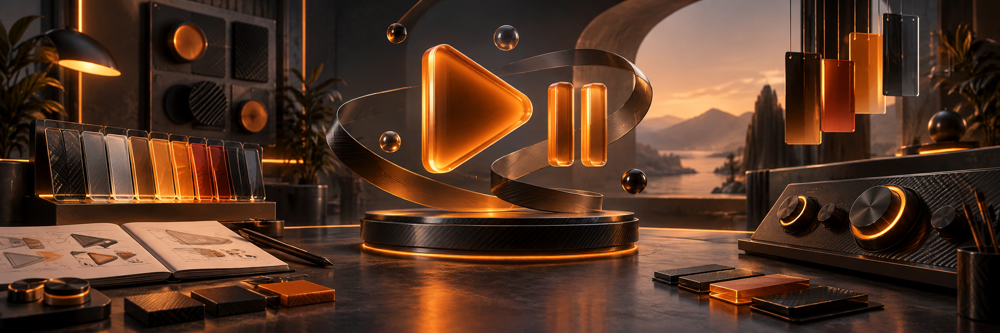
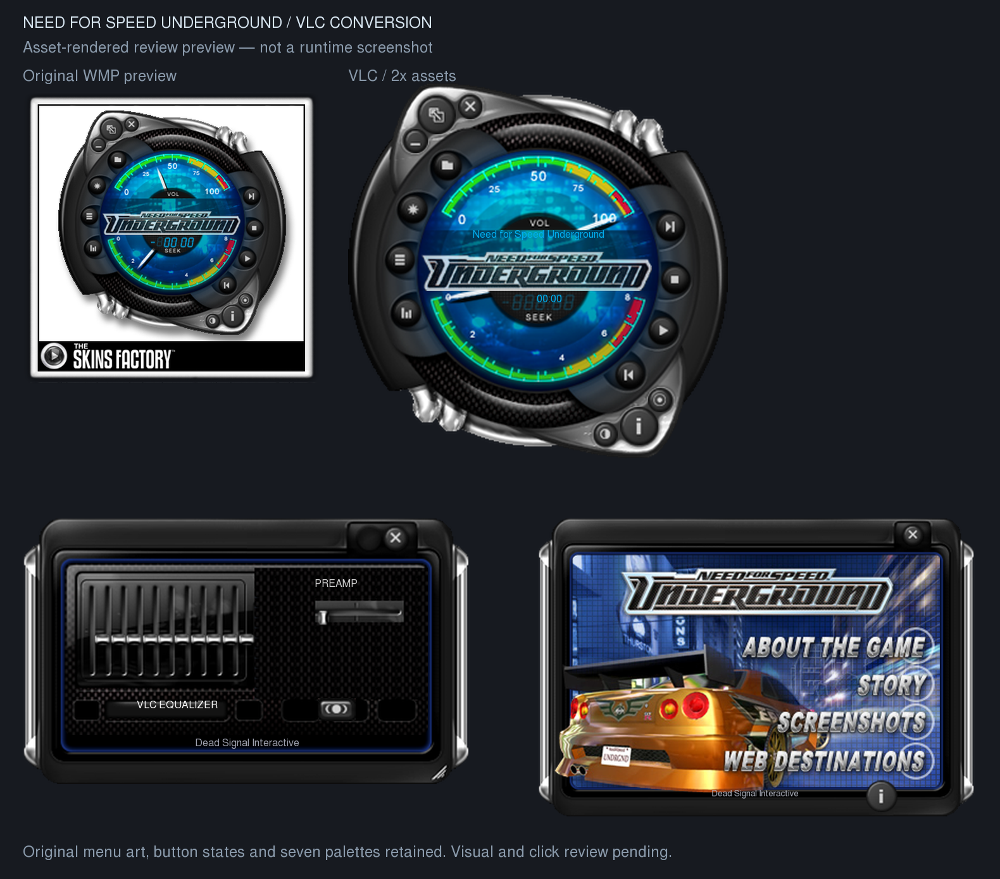

<!-- project-centered:start -->

<h1 align="center">VLC Skins</h1>

<!-- project-header:start -->

<!-- project-header:end -->

<!-- project-badges:start -->

  

<!-- project-badges:end -->

<!-- project-index:start -->

<h3 align="center">✦ Explore this project</h3>
<table align="center"><tbody><tr><td align="center"><a href="#readme-overview"><strong>Overview</strong></a></td><td align="center"><a href="#readme-section-1"><strong>Try it</strong></a></td></tr><tr><td align="center"><a href="#readme-section-2"><strong>Preserved and adapted</strong></a></td><td align="center"><a href="#readme-section-3"><strong>Build and verify</strong></a></td></tr><tr><td align="center" colspan="2"><a href="#readme-section-4"><strong>Credits</strong></a></td></tr></tbody></table>
<h4 align="center">Project shortcuts</h4>
<table align="center"><tbody><tr><td align="center"><a href="docs/VERIFICATION.md"><strong>VERIFICATION</strong></a></td><td align="center"><a href="docs/FULLSCREEN.md"><strong>FULLSCREEN</strong></a></td></tr><tr><td align="center"><a href="docs/SOUNDS-AND-HOVER.md"><strong>SOUNDS-AND-HOVER</strong></a></td><td align="center"><a href="requirements.txt"><strong>requirements.txt</strong></a></td></tr></tbody></table>

<a href="skins/README.md"><strong>✦ Browse the skin collection</strong></a>

<!-- project-index:end -->

<h2 align="center">Overview</h2>

Need for Speed Underground, converted from the original Windows Media Player 9 skin to native VLC Skins2. Conversion by **Dead Signal Interactive**; original skin by **The Skins Factory**.

**Status: both skins include a flat matching hover strip, centered speaker, lowered filename text, restored native tooltips and hover on inactive exposed video panes. The framed strip omits duplicate fullscreen/hide controls, and companion Settings/CC are now25px. All17 offline checks and78 private native assertions pass. The refined1x setup is running with its159-item queue,1080p,captions and settings preserved. Its solid fill and inset icons were visually confirmed;2x physical visual review remains pending.** See [current fixes and limits](docs/HUD-LAYOUT.md).

This comparison is rendered from the assets and XML, not captured from VLC. [Corrected intro frame sheet](docs/startup-frames.png).

<a href="#readme-index">↑ Back to index</a>

## Try it

<table align="center"><tbody><tr><td align="center"><a href="https://github.com/raiinman/VLC-Skins/releases/download/hud-layout-current-2026-10-16/Need-for-Speed-Underground-2x.vlt">2x skin</a>: 600 × 596 main player, for modern screens.</td></tr><tr><td align="center"><a href="https://github.com/raiinman/VLC-Skins/releases/download/hud-layout-current-2026-10-16/Need-for-Speed-Underground-1x.vlt">1x skin</a>: original 300 × 298 main player.</td></tr><tr><td align="center"><a href="https://github.com/raiinman/VLC-Skins/releases/download/hud-layout-current-2026-10-16/NFS-Current-Offline.zip">Complete matching review bundle</a>: both skins, helper, OSD script, settings dialog and launchers. Loading and offline checks pass; native visual/audio review remains separately scoped.</td></tr></tbody></table>

Future verified fixes refresh the complete NFS-Current-Offline bundle and its hash manifest; staging never installs or reloads a running skin.

Built VLTs are release assets; rebuilding creates ignored local copies in dist/. This keeps the large 2x archive outside regular Git file limits without changing its lossless artwork.

In VLC, choose **Tools → Preferences → Interface → Use custom skin**, select the VLT, save, then restart. [Official installation instructions](https://vlc-user-documentation.readthedocs.io/en/latest/addons/skins.html).

The star/visualization button opens the rectangular video window; the list button opens the original framed playlist; the bars button opens the equalizer. The small color button cycles seven palettes. The information button opens the original game menu, whose footer has a separate conversion credit button. Drag the frame to move a panel and its corner to resize the playlist or video.

The fullscreen button and the video pane's plus button fill the monitor **with the skin border**; click again to restore. Double-click the video for native **borderless fullscreen**. The original two-button header is preserved. See [fullscreen behavior and verification limits](docs/FULLSCREEN.md).

The support bundle's `Start-1x.cmd` and `Start-2x.cmd` also run the original skin sounds and framed video hover controls through a small Windows helper. Borderless fullscreen uses VLC's native hover controller. The launchers preserve existing sessions and use private per-scale settings. A VLT loaded alone needs the helper for sounds and framed hover. [Behavior and test limits](docs/SOUNDS-AND-HOVER.md).

The new hover strip stays 360 × 64 pixels on both skins, using original small transport buttons, a thin seek line and expandable volume. The framed strip uses an opaque matching charcoal fill; native fullscreen retains VLC's fade. Main filenames use larger white scrolling text. The bundled Lua interface requests VLC's native volume overlay when the dial changes. The current packages are installed in the user library; the fresh visible 1x session now uses the matching compact helper. [Compact controls](docs/COMPACT-CONTROLS.md).

The optional [companion HUD addon](docs/COMPANION-HUD.md) places Settings and CC in the existing compact strip without enlarging it. It requires companion-owned quality/caption wiring and is not added as an inert control to standalone VLTs.

Info pages now fade in/out at the original 400/500 ms timings, and Info frame colors fade for 700 ms. Tooltips use larger text; the helper prefers above the pointer. The playlist starts slightly larger with clearer text, keeps its lower-right resize corner, and the bundle's `Playlist-Text-Size.cmd` lets you save a personal text size for the next dedicated launch. The coordinated 1x update preserved all158 queue entries, playback state, volume and saved pane geometry; the playlist adopts its new slightly larger minimum. [Behavior and limits](docs/INFO-FADES.md).

<a href="#readme-index">↑ Back to index</a>

## Preserved and adapted

Original player artwork, hover/pressed buttons, seven palettes, information menu, game description, story pages, screenshots, startup animation and shutter frames are retained. The source is a WMZ/WMS package rather than a Winamp skin.

The video panel is rectangular and clear of the NFS logo. The seek and volume gauges keep the original needle sprites and horizontal drag mapping recovered from the source position maps. Click the clock to toggle elapsed and remaining time. The ten-band equalizer and preamp use VLC variables; obsolete WMP SRS/WOW, speaker-size, balance, crossfade and WMP visualization-preset controls are removed. Original skin effects are retained through the helper. VLC owns native context and settings dialogs; Skins2 cannot restyle their interiors. The skin's own information menu retains its original images.

The video panel now retains the user-selected size when media dimensions change. [Sizing source audit](docs/VIDEO-SIZING.md) records the policy and native review limits. The [layer comparison report](docs/visual-comparison.json) and source/converted/residual sheets compare retained art offline; omitted fonts and conversion additions are listed in the report.

Palette changes preserve the clock mode, shutter state and open panels. The information frame also follows the selected palette. Startup and shutter playback follow the original script timing.

The 2x package uses per-frame Lanczos resampling of the recovered originals. It does not invent higher-resolution detail. The preceding exact-hash Windows initialization measured8.27seconds at1x and28.27seconds at2x, separately from the roughly 8-second original intro; see [exact package measurements](docs/fast-load-benchmark.json). Lossless bands preserve every frame; only the 14 tall 2x Info rails now use four bands instead of two. Separate `Preview-1x.cmd` and `Preview-2x.cmd` launchers rewrite their adjacent isolated INI files to select the bundled skin and clear saved layouts before starting the intro. Fresh window positions fit a 1280×720 work area at 1x and 1920×1040 at 2x; existing saved positions can override them. Regular VLC launches may restore another saved layout and skip it; Information → conversion credits → Replay intro runs it again in the blue theme. [Control mapping and review limits](docs/PARITY.md).

<a href="#readme-index">↑ Back to index</a>

## Build and verify

Requires Python 3.11+, Pillow and lxml. Original extracted inputs and the font are included, so rebuilding does not need the Downloads file.

<table align="center"><tbody><tr><td align="left"><pre><code class="language-powershell">python -m pip install -r requirements.txt&#10;python tools/build.py&#10;python tools/companion_hud_assets.py&#10;python tools/check_contracts.py&#10;python tools/check_hits.py&#10;python tools/check_animation_bands.py&#10;python tools/check_startup.py&#10;python tools/check_source_art.py&#10;python tools/check_panels.py&#10;python tools/check_transitions.py&#10;python tools/check_placement.py&#10;python tools/check_launchers.py&#10;python tools/check_video.py&#10;python tools/check_corners.py&#10;python tools/check_palette.py&#10;python tools/check_effects.py&#10;python tools/check_hover.py&#10;python tools/check_readability.py --self-test&#10;python tools/check_info_fades.py&#10;powershell -NoProfile -ExecutionPolicy Bypass -File tools/build_effects.ps1&#10;powershell -NoProfile -ExecutionPolicy Bypass -File tools/Start-NFS.ps1 -SelfTest&#10;powershell -NoProfile -ExecutionPolicy Bypass -File tools/Playlist-Text-Size.ps1 -SelfTest&#10;python tools/compare_layers.py&#10;python tools/preview.py&#10;# Authorized native initialization check (private desktop; no input control):&#10;python tools/benchmark_load.py --output ../work/load-benchmark.json&#10;</code></pre></td></tr></tbody></table>

The optional volume-OSD mock test requires test-only `lupa==2.8` and runs with `python tools/check_osd.py` (or `--lua-python-path` for a private dependency directory). Python/Lupa are not required by the Windows review bundle.

The preceding f628/a1bf packages loaded in 8.27 seconds at 1x and 28.27 seconds at 2x, both within30seconds; those measurements are historical and do not certify the new cosmetic revision. Working sets after the intro were 517.8/1807.2 MiB; private memory was 490.4/1788.1 MiB. These are single warm-cache runs, not cold-start guarantees. The benchmark uses a copied portable runtime, silent audio and private non-input desktops without the effects helper; three protected processes, 16 guarded paths (11 existing files) and the input desktop were preserved. See [exact hashes and observations](docs/fast-load-benchmark.json). The earlier memory-first loading regressions remain [historical results](docs/LOADING-AND-MEMORY.md). All 17 conversion/visual checks pass, including 714 exact layer cases and 42 explained residuals with zero unexplained cases. [Exact frame/pixel equivalence and remaining limits](docs/FAST-LOADING.md) are separate from live visual/audio confirmation.

To repeat recovery from the supplied package:

<table align="center"><tbody><tr><td align="left"><pre><code class="language-powershell">python tools/build.py --source "C:/path/to/Need_for_Speed_Underground.wmz"&#10;</code></pre></td></tr></tbody></table>

Extraction checks every member path and CRC. Only the known four-byte local ZIP signature replacement is made, in memory. The original file is untouched. [Provenance manifest](skins/need-for-speed-underground/provenance.json).

DOX is installed as the root and child AGENTS.md hierarchy, copied and adapted from [raiinman/dox](https://github.com/raiinman/dox). [Attribution and dependency sources](docs/SOURCES.md).

<a href="#readme-index">↑ Back to index</a>

## Credits

Original skin: **The Skins Factory**. Original copyright: **© 2003 Electronic Arts Inc. All Rights Reserved.** Conversion: **Dead Signal Interactive**. Original materials retain their owners' rights. This private review repository does not assign a new license to the recovered artwork, scripts or branding.

The lower-right resize corner now uses matching original artwork at both scales. [Corner fix](docs/CORNER-FIX.md) explains the Windows cache-copy defect and the remaining native appearance check. Already running or derived copies must be regenerated/reloaded to use the new assets.

Shutter and clock changes now leave auxiliary pane artwork stable. [Shutter isolation](docs/SHUTTER-ISOLATION.md) records the limited native 1x retest and saved-color migration. Review launchers start fresh; when upgrading an existing colored normal profile, close its VLC instance and run `python tools/migrate_palette.py "C:/path/to/vlcrc"` once before loading the new skin. The tool backs up the selected file and preserves other preferences and pane positions.

<a href="#readme-index">↑ Back to index</a> · <a href="#readme-top">Back to top ↑</a>

<!-- project-centered:end -->
