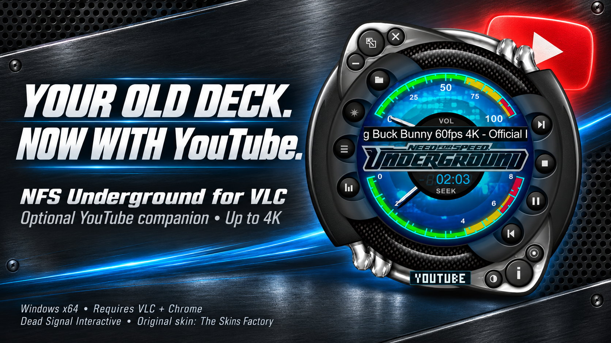

# NFS Underground for VLC

**Your old media player. Back on your desktop.**

The classic Need for Speed Underground skin, made for VLC on Windows.

[Install](#install-the-skin) · [YouTube & extras](#youtube--extras) · [Controls](#controls) · [Help](#help) · [Credits](#credits)

*Original-size 1x release. 2x is still being worked on.*

## Install the skin

1. [Download the skin](https://github.com/raiinman/VLC-Skins/releases/download/nfs-underground-1x-v1.0.0/Need-for-Speed-Underground-1x.vlt). Keep it as a `.vlt` file. Do not unzip it.
2. In VLC, open **Tools → Preferences → Interface → Use custom skin**. Click **Choose** and select the downloaded file.
3. Click **Save**, then close and reopen VLC.

That is it. **No compiling. No Python. No extra tools.**

Need VLC? [Get VLC for Windows](https://www.videolan.org/vlc/). [Official skin instructions](https://vlc-user-documentation.readthedocs.io/en/latest/addons/skins.html).

## YouTube & extras

Want YouTube in its own matching pane, original skin sounds, and controls that appear over the video?

[Download the optional Windows companion](https://github.com/raiinman/VLC-Skins/releases/download/nfs-underground-1x-v1.0.0/NFS-Underground-1x-Companion-Windows-x64.zip), unzip it, and follow its **START-HERE.txt** file. It includes the ready-to-run programs and its own Python runtime. You do not compile or install developer tools. It requires installed **64-bit VLC and Google Chrome**.

| Skin file | Optional companion |
| --- | --- |
| Original artwork, seven colours, startup and shutters | Original skin sounds with their own volume control |
| Playlist and equalizer | Compact controls over framed video |
| Resizable video with the original border | YouTube browsing and native VLC playback, up to 4K when available |
| Clock, seek and volume dials | Highest-first Auto quality with buffering fallback; manual quality and available captions |

The companion is a separate download. Loading the `.vlt` alone does not add YouTube or run the helper programs.

## Controls

- **Folder:** open music or video.
- **List:** open the playlist. **Bars:** open the equalizer.
- **Colour button:** cycle the seven colours. **Clock:** switch elapsed/remaining time.
- **Video + button:** fill the screen with the skin border; click again to restore.
- **Double-click video:** fullscreen without the border.
- **Info:** explore the original game pages and conversion credits.

The playlist and video panes can be resized from their bottom-right corners.

## Help

[Report a problem](https://github.com/raiinman/VLC-Skins/issues/new). Tell us your VLC version and whether you use the companion.

To return to regular VLC, choose **Use native style** in Interface preferences, then restart VLC.

This release targets **Windows and VLC 3, 64-bit**. Skins are not supported on macOS. The original 1x player is small by design (300 × 298). Some original WMP-only controls are omitted; fonts and video sizing are adapted for VLC. The companion's public-video 4K tests passed, but some seeks needed up to 20 seconds to recover. Private videos, age restrictions and account history are not promised.

[Release notes](https://github.com/raiinman/VLC-Skins/releases/tag/nfs-underground-1x-v1.0.0) · [Detailed behaviour and limits](docs/PARITY.md) · [Verification](docs/VERIFICATION.md) · [Developer notes](docs/DEVELOPMENT.md)

## Credits

Original skin: **The Skins Factory**. VLC conversion: **Dead Signal Interactive**. Built with AI assistance.

Original copyright: **© 2003 Electronic Arts Inc. All Rights Reserved.** Original artwork and branding belong to their owners. This fan conversion does not claim their ownership or endorsement. [Sources and notices](docs/SOURCES.md) · [Licensing](LICENSE.md).

