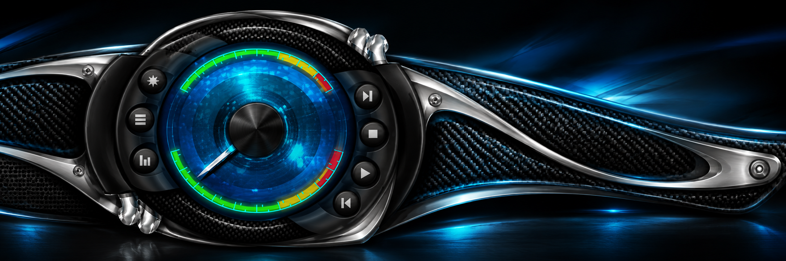
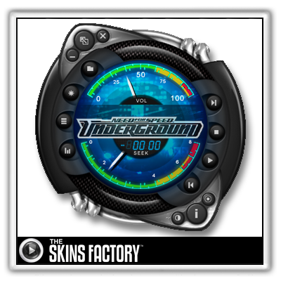

<!-- project-centered:start -->

<h1 align="center">Need for Speed Underground</h1>

<strong>A classic dashboard, rebuilt for VLC.</strong>

  

<h3 align="center">✦ Explore this skin</h3>
<table align="center"><tbody>
<tr><td align="center"><a href="#editions"><strong>Choose your scale</strong></a></td><td align="center"><a href="#look-and-credits"><strong>Look &amp; credits</strong></a></td></tr>
<tr><td align="center"><a href="#source-map"><strong>Source &amp; build folders</strong></a></td><td align="center"><a href="#verification"><strong>Verification &amp; support</strong></a></td></tr>
</tbody></table>

<a href="../README.md">← Skin collection</a> · <a href="../../README.md">Repository guide</a>

<h2 align="center">Choose your scale</h2>

The original Windows Media Player 9 skin by <strong>The Skins Factory</strong>, converted to VLC Skins2 by <strong>Dead Signal Interactive</strong>.

<table align="center"><thead><tr><th align="center">Edition</th><th align="center">Main player</th><th align="center">Download</th><th align="center">Build files</th></tr></thead><tbody>
<tr><td align="center"><strong>Original scale · 1x</strong></td><td align="center">300 × 298</td><td align="center"><a href="https://github.com/raiinman/VLC-Skins/releases/download/ui-polish-current-2026-10-15/Need-for-Speed-Underground-1x.vlt">1x VLT</a></td><td align="center"><a href="https://github.com/raiinman/VLC-Skins/tree/main/skins/need-for-speed-underground/vlc-1x">vlc-1x</a></td></tr>
<tr><td align="center"><strong>Lossless scale · 2x</strong></td><td align="center">600 × 596</td><td align="center"><a href="https://github.com/raiinman/VLC-Skins/releases/download/ui-polish-current-2026-10-15/Need-for-Speed-Underground-2x.vlt">2x VLT</a></td><td align="center"><a href="https://github.com/raiinman/VLC-Skins/tree/main/skins/need-for-speed-underground/vlc-2x">vlc-2x</a></td></tr>
</tbody></table>

Both scales come from the retained source artwork. Current package status, native loading limits, and visual acceptance are recorded in the <a href="../../docs/VERIFICATION.md">verification record</a>; current UI refinements and private native hover checks are in UI-POLISH.md; full visual parity acceptance remains open.

<a href="#readme-index">↑ Back to index</a>

<h2 align="center">Look &amp; credits</h2>

Electric blue gauges, woven carbon fiber, sculpted dark controls, brushed chrome, and vivid green accents define this skin’s period appearance. The decorative banner above is newly generated artwork inspired by that material and color language. It is not a runtime capture or replacement skin asset.

<em>Historical source preview. Original skin: The Skins Factory. VLC conversion: Dead Signal Interactive.</em>

Original artwork and attribution remain with their respective owners. See the <a href="../../README.md#readme-section-4">repository credits</a> for the full provenance and terms.

<a href="#readme-index">↑ Back to index</a>

<h2 align="center">Source &amp; build folders</h2>
<table align="center"><thead><tr><th align="center">Folder / file</th><th align="center">Purpose</th></tr></thead><tbody>
<tr><td align="center"><a href="https://github.com/raiinman/VLC-Skins/tree/main/skins/need-for-speed-underground/original">original</a></td><td align="center">Retained original resources and historical preview.</td></tr>
<tr><td align="center"><a href="provenance.json">provenance.json</a></td><td align="center">Original member inventory and CRC provenance.</td></tr>
<tr><td align="center"><a href="https://github.com/raiinman/VLC-Skins/tree/main/skins/need-for-speed-underground/vlc-1x">vlc-1x</a></td><td align="center">Generated VLC theme at original scale.</td></tr>
<tr><td align="center"><a href="https://github.com/raiinman/VLC-Skins/tree/main/skins/need-for-speed-underground/vlc-2x">vlc-2x</a></td><td align="center">Generated VLC theme at double scale.</td></tr>
</tbody></table>

The generated theme folders are built by <a href="../../tools/build.py">tools/build.py</a>. Banner art and documentation live beside them, outside the retained originals and generated theme packages.

<a href="#readme-index">↑ Back to index</a>

<h2 align="center">Verification &amp; support</h2>
<table align="center"><tbody>
<tr><td align="center"><a href="../../docs/VERIFICATION.md"><strong>Current verification</strong></a></td><td align="center"><a href="../../docs/FULLSCREEN.md"><strong>Fullscreen behavior</strong></a></td></tr>
<tr><td align="center"><a href="../../docs/SOUNDS-AND-HOVER.md"><strong>Sounds &amp; hover helper</strong></a></td><td align="center"><a href="../../docs/COMPACT-CONTROLS.md"><strong>Compact controls</strong></a></td></tr>
<tr><td align="center"><a href="../../README.md"><strong>Installation &amp; build guide</strong></a></td><td align="center"><a href="readme-banner-prompt.txt"><strong>Banner generation brief</strong></a></td></tr>
</tbody></table>

<a href="#readme-index">↑ Back to index</a> · <a href="#readme-top">Back to top ↑</a>

<!-- project-centered:end -->
